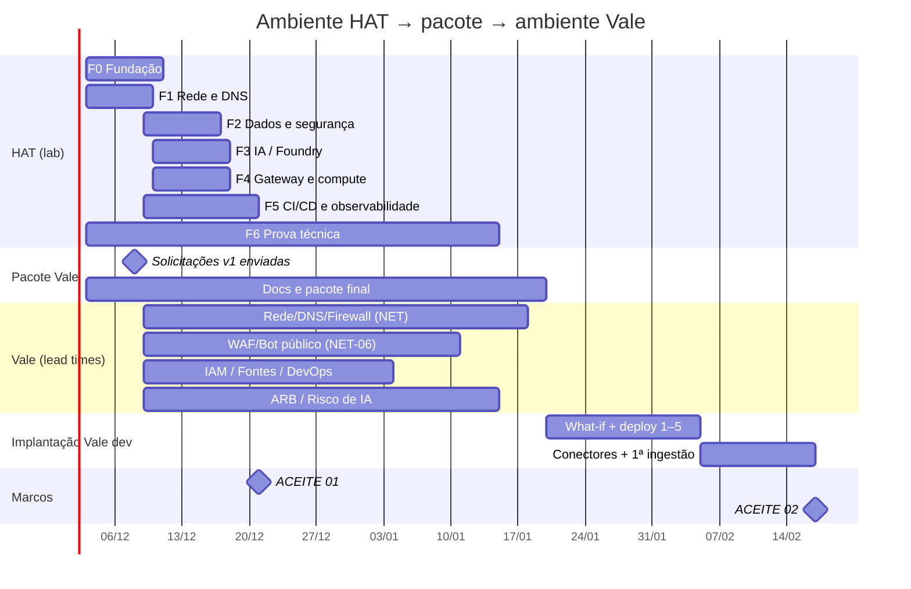

# 05 · Cronograma — visão executiva

> Planilha completa (114 tarefas, Gantt semanal, status editável): `cronograma/Cronograma_HAT_Vale_CDI.xlsx`.
> Abas: **Resumo** · **Cronograma** (tarefas agrupadas por entrega, com o agente que cada uma habilita) · **Entregas e agentes** · **Solicitações Vale** (rastreio das 34) · **Feriados** · **Riscos**.

**Entregas (o "todo" de cada tarefa):** ENT-01 Plano e combinados · ENT-02 Laboratório HAT (rede, segurança, dados) · ENT-03 Plataforma de IA · ENT-04 Porta de entrada (APIM) · ENT-05 Canal do Teams (A1) · ENT-06 Esteira e painel · ENT-07 Base de conhecimento · ENT-08 Piloto do A2 · ENT-09 Pacote para a Vale · ENT-10 Acessos na Vale · ENT-11 Ambiente Vale no ar · ENT-12 Fontes reais conectadas · ENT-13 Aceites e passagem de bastão.

**Agentes:** A1 Analista de Negócio · A2 Engenheiro de Integração · A3 Suporte · A4 Conhecimento · *Todos* = fundação comum · *Gestão* = sem agente específico.
> Início de referência: **seg 30/11/2026**. Datas em dias úteis com feriados nacionais e recesso 24 e 31/12.

## 1. Linha do tempo

## 2. Marcos

| Marco | Data prevista | Condição |
|---|---|---|
| Pacote de solicitações v1 enviado à Vale | **08/12/2026** | docs/03 + .docx (já elaborados neste pacote) |
| Ambiente HAT pronto (F0–F5) | **21/12/2026** | `04-validate.sh lab` verde + recriação total via pipeline |
| **ACEITE 01** — Arquitetura e plano de execução | **21/12/2026** | Roteiro, matriz RBAC, ambiente HAT validado, solicitações enviadas |
| Prova técnica no lab (ingestão → MCP → A2 matriz) | **15/01/2027** | Matriz ICC015 × código com citações |
| Parecer do ARB da Vale (SOL-SEG-01) | **15/01/2027** | Revisão iniciada em 22/12 com as evidências do lab |
| Pacote final (IaC + evidências + runbook) | **20/01/2027** | `vale-dev.bicepparam` preenchido |
| Ambiente Vale dev implantado e validado | **05/02/2027** | `04-validate.sh vale-dev` verde |
| **ACEITE 02** — Base pronta para construir | **17/02/2027** | Conectores reais + 1ª ingestão controlada |
| Handover IaC/operação + preparação QA/PRD | **22/02/2027** | 2 workshops; params de QA/PRD |
| Pentest do endpoint público (SOL-SEG-04) | **02/03/2027** | Antes do piloto do A1 com usuários no Teams |

## 3. Caminho crítico (o que realmente define a data do ACEITE 02)

`Alinhamento com Vale → envio das solicitações (08/12) → SOL-NET-01 VNet/subnets (22/12) → SOL-NET-04 DNS do hub (18/01) → bicepparam Vale (19/01) → what-if/policies (22/01) → deploys 1–4 (03/02) → pós-deploy → conectores reais (12/02) → 1ª ingestão (17/02)`

**Leitura:** o ambiente HAT fica pronto em ~3 semanas; o que empurra a base na Vale para meados de fevereiro são **lead times de rede/DNS da Vale cruzando o fim de ano**. Ações para antecipar em até ~2 semanas:

1. Enviar o pacote **já na semana 1** (os documentos deste pacote permitem isso) — e não esperar o lab terminar.
2. Pedir à Vale que trate SOL-NET-01/02/04 como **um único CR** antes do freeze.
3. Se a Vale usar policy DINE para DNS, SOL-NET-04 cai para poucos dias (registro automático).
4. Rodar o deploy Vale em **ondas**: dados e Foundry (deploy 2–3) não dependem do WAF/Bot (SOL-NET-06, o item mais difícil), que pode entrar depois do ACEITE 02.

## 4. Distribuição por categoria e dificuldade

| Categoria | Baixa | Média | Alta | Muito alta | Total | Esforço HAT (d-p) |
|---|---|---|---|---|---|---|
| A. Governança e mobilização | 3 | 2 | 0 | 0 | 5 | 5,5 |
| B. HAT F0 — Fundação | 4 | 4 | 0 | 0 | 8 | 5,5 |
| C. HAT F1 — Rede e DNS | 1 | 3 | 0 | 0 | 4 | 3 |
| D. HAT F2 — Dados e segurança | 2 | 5 | 3 | 0 | 10 | 9,5 |
| E. HAT F3 — IA / Foundry | 0 | 4 | 2 | 1 | 7 | 6,5 |
| F. HAT F4 — Gateway e compute | 0 | 3 | 5 | 0 | 8 | 8,5 |
| G. HAT F5 — CI/CD e observabilidade | 0 | 4 | 2 | 0 | 6 | 7,5 |
| H. HAT F6 — Prova técnica | 0 | 1 | 4 | 2 | 7 | 20,5 |
| I. Documentação e pacote Vale | 1 | 7 | 0 | 0 | 8 | 10 |
| J. Solicitações Vale (34 + envio) | 7 | 18 | 9 | 1 | 35 | 17,5 (acompanhamento) |
| K. Implantação Vale (dev) | 0 | 4 | 7 | 1 | 12 | 15 |
| L. Aceites e handover | 0 | 2 | 2 | 0 | 4 | 4 |
| **Total** | | | | | **114** | **≈ 95,5 (HAT)** |

**Escala de dificuldade:** *Baixa* = rotina documentada, < 1 dia · *Média* = decisões ou dependência de outra área · *Alta* = integra vários serviços/rede privada/RBAC, risco de retrabalho · *Muito alta* = componente em preview, ordem crítica ou código de produto (ingestão, MCP).

**Capacidade:** 3 engenheiros HAT em tempo integral + GP 30% ≈ 210 dias-pessoa em 13 semanas; o plano usa ~95 em infra/habilitação, sobrando capacidade para o backlog funcional dos agentes (Mês 3 do deck).

## 5. Relação com o cronograma de desembolso (slide 33)

| Mês (deck) | Período | O que este plano entrega |
|---|---|---|
| Mês 1 — Assessment (R$ 70 mil) | dez/2026 | Ambiente HAT, blueprint/ADRs, pacote de solicitações, **ACEITE 01** |
| Mês 2 — Foundation (R$ 80 mil) | jan/2027 | Prova técnica (knowledge foundation MVP no lab), pacote final, início do deploy Vale |
| Mês 3 — Agentes 1ª onda (R$ 90 mil) | fev/2027 | Base Vale pronta (**ACEITE 02** em 17/02, ~2 semanas após o ideal), conectores reais |
| Mês 4 — Operations (R$ 80 mil) | mar/2027 | Handover IaC, QA/PRD, hypercare |

> ⚠️ Com lead times "típicos", o ACEITE 02 escorrega para dentro do Mês 3. Vale negociar com a Vale o tratamento expresso das solicitações de rede, ou redefinir o ACEITE 02 para "base pronta **no ambiente HAT** + implantação Vale em andamento".
